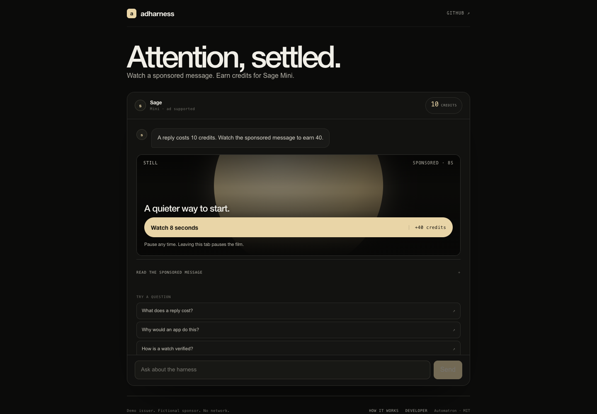

# Ad Harness

**Attention, settled.**

An inline sponsored credit component for LLM chat. The person watches a short
sponsored card inside the conversation. The sponsor covers the inference. The
credit chip and the receipt show exactly what moved.



[Read the protocol](docs/PROTOCOL.md) · [Inline placements](docs/PLACEMENTS.md)
· [Integrate the component](docs/INTEGRATION.md) · [Security boundary](docs/SECURITY.md)
· [Functional Minimalism review](docs/FUNCTIONAL-MINIMALISM.md)
· [Design notes](docs/DESIGN.md)

## What this is

An LLM app can run out of credits. Ad Harness gives it one honest option: place
a labelled sponsored card in the conversation, verify that it was watched, and
grant a credit receipt the host can redeem exactly once.

The demo is a working end to end reference. The card sits between the assistant
intro and the next turn. A chat reply costs 10 credits. An 8 second sponsored
card earns 40 credits for **Sage Mini**. The player pauses when the tab is
hidden or the card leaves the view. Completion produces a claim. The host checks
the claim, verifies a signed receipt and updates the credit chip. Replaying the
receipt is refused.

The page follows the Functional Minimalism harness: the working chat and the
inline sponsored card lead. The credit chip stays in the host bar. **How it
works** holds the optional explanation and boundary. **Developer** holds the
receipt, event trace, inline placement and host verification. The first view
does not require an introductory read. The review and its limits are recorded in
[docs/FUNCTIONAL-MINIMALISM.md](docs/FUNCTIONAL-MINIMALISM.md).

No account, API key, ad network or backend is connected.

## Run it locally

Node 22.12 or newer is required for development (`.nvmrc` pins 24.16).

```sh
npm ci --ignore-scripts
npm run dev
```

Open `http://127.0.0.1:4173/`. The page is self contained. It uses no external
fonts, images, scripts or requests.

The same contract is available in the terminal:

```sh
node bin/ad-harness.mjs demo
```

```text
Ad       still-launch · Still · 15s · +40
Claim    valid · 15000ms · nonce 80sDPOch
Receipt  rcpt_mjzrBuiNBWzJlBOQizjLs3 · signature valid
Ledger   +40 · balance 50
Boundary demo issuer only · no advertiser or payment is connected
```

The CLI uses the bundled 15 second Still definition. The browser demo uses an
8 second inline sample with the same reward and protocol.

The CLI writes fresh claims, validates them and credits a fresh ledger:

```sh
node bin/ad-harness.mjs sample --out claim.json
node bin/ad-harness.mjs verify claim.json
node bin/ad-harness.mjs credit claim.json
```

## One component

`<ad-harness>` is a framework independent custom element. It owns attention. It
never changes a balance.

Place it between turns, not inside a model answer:

```html
<div class="conversation">
  <assistant-message>...</assistant-message>
  <ad-harness
    ad-id="still-inline"
    sponsor="Still"
    title="A quieter way to start."
    duration="8"
    reward="40"
  >
    <!-- a brand logo, image, video or other host supplied creative -->
  </ad-harness>
  <assistant-message>...</assistant-message>
</div>
```

| Attribute  | Default                      | Meaning                                |
| ---------- | ---------------------------- | -------------------------------------- |
| `ad-id`    | `sponsored-message`          | The ad identity the claim is bound to. |
| `sponsor`  | `Sponsor`                    | The sponsor label in the chrome.       |
| `title`    | `A short sponsored message.` | The idle headline.                     |
| `duration` | `15`                         | Seconds. Clamped to 5 through 120.     |
| `reward`   | `40`                         | Credits. Clamped to 1 through 1000.    |
| `disabled` | absent                       | Closes the player for this session.    |

Methods: `start()`, `pause(reason?)`, `resume()`, `reset()`.

Properties: `status`, `elapsedMs`, `claim`, `durationMs`, `reward`.

Events bubble and cross the shadow boundary:

| Event                 | Detail                                      |
| --------------------- | ------------------------------------------- |
| `adharness:ready`     | `{ adId, durationMs, reward }`              |
| `adharness:started`   | `{ adId, durationMs, reward, attempt }`     |
| `adharness:progress`  | `{ adId, elapsedMs, durationMs, progress }` |
| `adharness:paused`    | `{ adId, elapsedMs, reason }`               |
| `adharness:resumed`   | `{ adId, elapsedMs }`                       |
| `adharness:completed` | `{ claim }`                                 |
| `adharness:reset`     | `{ adId }`                                  |

The clock pauses when the document is hidden, when the card leaves the
conversation view and when the host disables the element. It does not auto
resume. A background tab cannot earn credits.

## One proof

A completed watch produces a completion claim:

```json
{
  "version": 1,
  "adId": "still-launch",
  "sessionId": "ses_example",
  "startedAt": 1794926880661,
  "completedAt": 1794926895688,
  "elapsedMs": 15000,
  "reward": 40,
  "nonce": "80sDPOch2cgTN0d5c_uYfRZq"
}
```

The host checks the ad, reward, session, nonce, elapsed time, timestamps and
freshness. A claim older than five minutes is refused. The demo issuer then
returns a receipt with a `receiptId`, `issuedAt` and HMAC signature.

The signature proves the claim survived the code path. It does not prove an ad
network served the message. Production verification belongs on a server.

## One ledger

`creditReceipt` is pure. It returns a new ledger and refuses:

- a receipt that was already credited (`receipt_used`)
- a claim for another ad (`ad_mismatch`)
- a reward that does not match the published reward (`reward_mismatch`)
- a short watch, expired claim or malformed nonce (`claim_invalid`)
- a tampered receipt (`signature_invalid`)
- a session beyond its cap (`session_cap`)
- a spend below zero (`insufficient_credits`)

The demo starts at 10 credits, charges 10 per reply, rewards 40 per 8 second
inline watch and caps the session at 3 watches. Credits are scoped to **Sage
Mini** in the demo. The **Replay the last receipt** control proves the second
credit is refused while the balance stays unchanged.

## Boundary

This is a working reference, not an ad network. The sponsor is fictional. The
demo issuer runs in the browser and its key is public on purpose.

Production needs three things this repository deliberately leaves to the host:

1. A server side verifier that runs outside the client.
2. A completion proof signed by the ad network, bound to one ad and one session.
3. A billing agreement with the sponsor. Credits are not money.

No targeting, telemetry, cookies or third party requests are used. The page CSP
sets `connect-src 'none'`.

## Verify

```sh
npm test          # protocol, issuer, CLI and export tests
npm run check     # tests plus static checks for network primitives and CSP
npm run test:browser  # Chrome inline flow, pause, replay, mobile layout
npm run build:site    # static site in _site/
```

The browser check covers the inline card, the model scoped credit chip, the
Developer and How it works dialogs, pause and resume, receipt replay, reset,
offscreen pause and the 390 pixel layout. It needs Google Chrome. Set
`CHROME_PATH` if Chrome is not in its default location.

## Project layout

```text
src/protocol.mjs       claim validation, receipts, ledger
src/issuer.mjs         demo HMAC issuer and verifier
src/element.mjs        <ad-harness>, shadow DOM, timer and events
src/index.mjs          public exports
bin/ad-harness.mjs     verify, credit, sample and demo commands
index.html             working host app, How it works and Developer dialogs
app.mjs                demo host state and DOM
styles.css             page and sponsor film styles
examples/              bundled ad definition and sample claim source
docs/                  protocol, placements, integration, security, design, roadmap
test/                  Node tests
scripts/               dev server, static check, site build, browser check
```

[Maintaining](MAINTAINING.md) records the release and rollback loop.

## Status

v0.1 is a local first reference. The package is `private: true` until the owner
chooses a distribution route. The repository and GitHub Pages workflow are
prepared but publication is a separate action.

The next tests should run with a real ad network verifier, a server side cap,
and a short user study of whether the exchange and the model scope are
understood without opening How it works.
